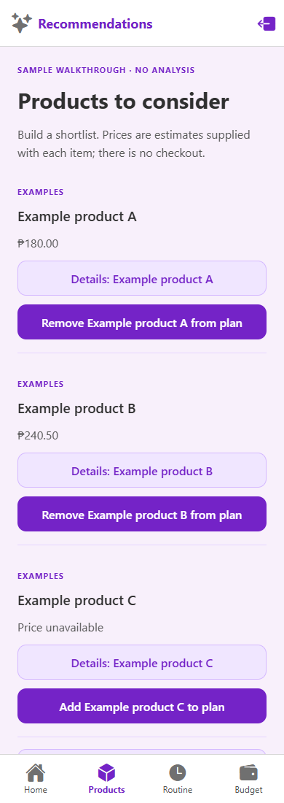
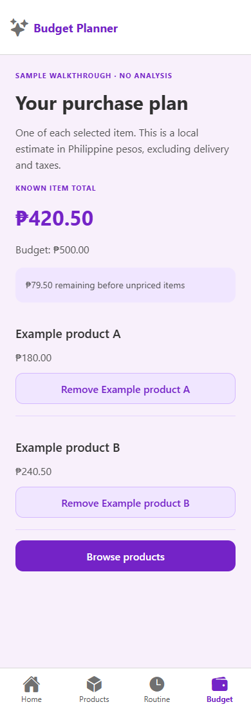
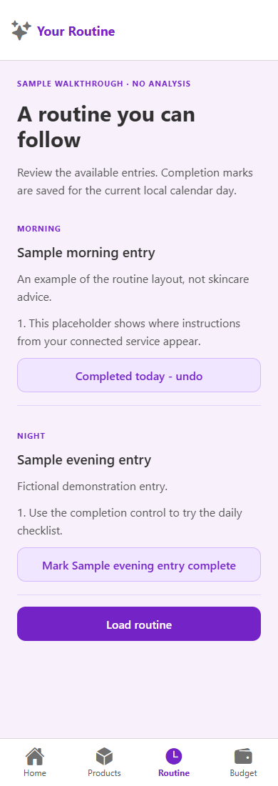

# SeraFace

A React Native skincare workspace for keeping a profile, reviewing products, planning a budget and following a routine. The project brings those steps into one mobile client instead of separate forms and lists.

**Start with the local sample walkthrough.** It uses fictional products and routine entries to demonstrate the app. No AI runs, no photo is required, and no profile is sent to a server. Connecting a compatible service enables the profile and photo submission flow; the service itself is not included in this repository.

## A look inside

These are actual browser previews of the Expo app at a phone-sized viewport, showing explicitly labeled sample data.

| Product shortlist | Purchase plan | Daily checklist |
| --- | --- | --- |
|  |  |  |

## What you can do

- Keep a skin type, optional conditions and allergies, goals, product experiences and a budget in Philippine pesos.
- Review a report from a connected service, or try the clearly labeled sample report.
- Browse every returned product, open its details and add or remove it from a local purchase plan.
- Compare known item prices with your budget. Items without prices are marked separately, so an incomplete total is never presented as a complete estimate.
- Load routine entries and mark them complete for the current local calendar day.
- Reopen your saved profile and plan, retry a failed save, or clear the local workspace from Home.

There is no checkout, account login, cloud sync, chatbot or community feed. A service session identifies a workflow; it is not an authenticated user account.

## Run locally

Use Node.js 22.13 or newer in the Node 22 line, or Node.js 24+, and npm.

```sh
git clone https://github.com/CPE3B-ersando-aarongabriel/Seraface-Mobile-App.git
cd Seraface-Mobile-App
npm ci
npm run web
```

Open the local address Expo prints. No environment file is needed for sample mode.

For a native development build, install the Android SDK and a compatible JDK, connect an Android device or start an emulator, then run `npm run android`. On macOS with Xcode installed, use `npm run ios`. These commands generate the native projects from `app.config.js`. The screenshots above are web previews, not Android or iOS captures.

## Try the walkthrough

1. Open **Skin profile** from Home. Choose a skin type, enter a budget such as `500`, and add a goal. Conditions and allergies can stay empty.
2. Optionally add a past product experience. You can remove it before continuing.
3. Choose **Continue sample walkthrough**, then **View sample report**. The report explains that no analysis took place.
4. Open **Products** and choose **Load products**. Add Example products A and B to your plan.
5. Open **Budget**. Their known total is ₱420.50, leaving ₱79.50 from a ₱500 budget. Example product C demonstrates a missing price.
6. Open **Routine**, load the sample entries and mark one complete. Reload the app to see the saved workspace.

Submitting a new profile starts a new plan and clears the previous report, product choices and checklist. Loading products or routines is an explicit action; the app does not repeatedly request them in the background.

## Connect your own service

Copy `.env.example` to `.env.local`, set `EXPO_PUBLIC_SERAFACE_API_URL` to your compatible service's HTTPS address, then restart Expo:

```sh
npm start -- --clear
```

This address is public app configuration, not a place for a secret key. For a service running on the same computer as the web preview, a loopback HTTP address is also supported. On a phone, localhost refers to the phone itself.

The client follows four stages: profile submission, image analysis, product recommendations and routine creation. It sends the returned session ID with subsequent requests. Your service must implement the [client contract](docs/REVIEW.md#service-contract) and permit the browser origin if you use web mode.

In connected mode, the app names the destination before submission. Selecting a JPEG, PNG or WebP photo does not upload it; **Send photo for analysis** does. The photo must be smaller than 5 MB. Failed or malformed responses show an error and never fall back to fictional findings. Service output is displayed as supplied; the client does not establish its clinical accuracy.

## How it is built

Expo and React Native provide the shared web, Android and iOS client. React Navigation supplies the tab and detail flows. Redux Toolkit manages the profile, results, product selection and daily completion state; RTK Query handles the staged service requests. AsyncStorage saves a validated, versioned local snapshot while leaving temporary photos and loading flags out of storage.

The original purple/pink palette and profile-choice layout are retained. Shared page and action components keep the newer product, budget and routine views readable on a phone or a wider browser window.

| Area | Source |
| --- | --- |
| Navigation | `App.js` |
| Main tabs | `screens/Major_Screens/` |
| Profile, photo, report and product details | `screens/Minor_Screens/` |
| Shared layout and controls | `components/Workspace.jsx` |
| Service requests | `store/api/` |
| Saved workspace and recovery | `store/index.js` |
| Money, validation and product normalization | `util/model.mjs` |
| Fictional walkthrough data | `util/sample.mjs` |
| Visual conventions | `DESIGN.md` |

To adapt the client, start with the response boundary in `util/model.mjs` and the four-stage API module. Keep the sample fixtures separate from real results, and preserve unknown-price handling when changing the product model.

## Your local data

Profile drafts, service results, selected products and completion marks stay in this app's local storage without encryption. Selected photos are held in memory only and need to be selected again after a reload. Sample and connected workspaces are stored separately for each service address.

Use **Home → Clear local data** to clear the current workspace. Clearing browser/app storage also removes it. Earlier prototype snapshots are not imported. Use one app window at a time: there is no cross-window synchronization or backup service. A purchase plan is an estimate for one of each selected item, excluding delivery and taxes; it never places an order.
